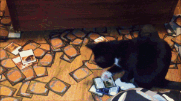

  

# Hi there 👋🏻

Full-Stack Developer with a UX eye, building with Nuxt.

Projects, blog and everything else live on my site: **[portfolio.emanuele-nardi.workers.dev](https://portfolio.emanuele-nardi.workers.dev)**

- 🌊 Part of the Pauper Magic community behind [pauperwave.org](https://pauperwave.org/): tournament dashboards at [app.pauperwave.org](https://app.pauperwave.org/) and a blog platform at [blog.pauperwave.org](https://blog.pauperwave.org)
- 📫 Reach me at emanuelenardi.dev@gmail.com
